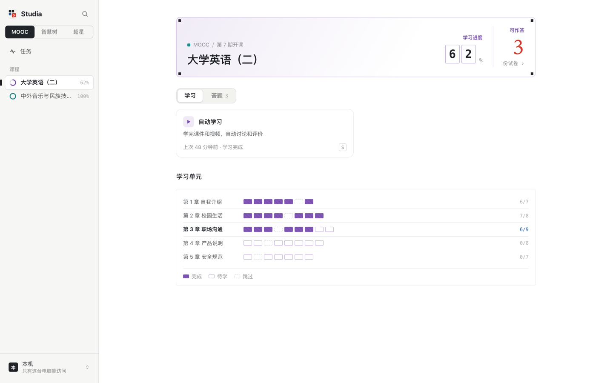
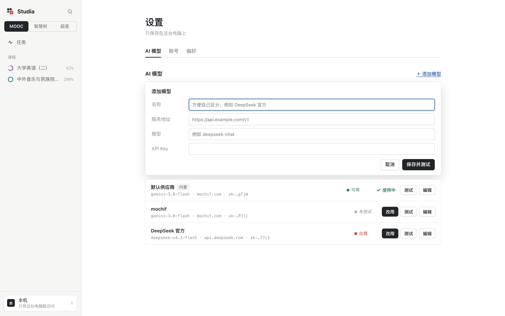
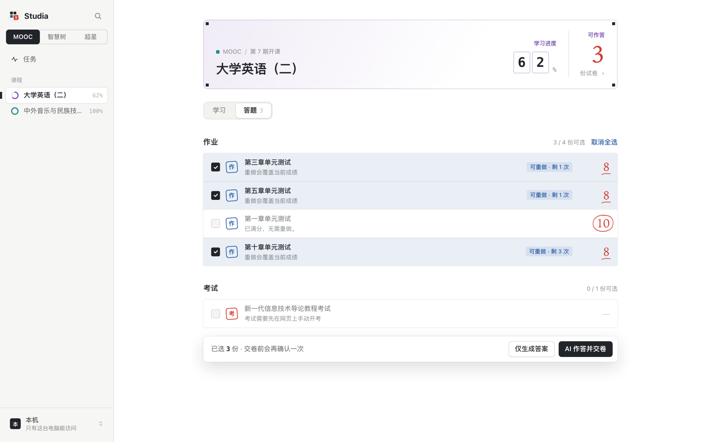

# Studia · 网页版懒人教程

自动学习 + AI 答题，全程在**浏览器里点**，不用敲命令。
填一次你自己的 API Key，之后扫码、勾试卷、等它跑完就行。

> 本教程只讲**网页版 + 自己的 API Key**。终端版、Docker 多人部署见 [docs/USAGE.md](docs/USAGE.md)。

---

## 它是什么

一个跑在自己电脑上的小网站。你在网页里登录学习平台、勾选课程和试卷，它在后台自动刷课、调模型答题、交卷。

智慧树共享课还支持**见面课回放签到**和**掌握度学习**（AI 作答知识点练习，跳过满分和免考的知识点，每个最多练 3 次）；智慧职教资源库只支持自动学习。



| 平台 | 自动学习 | AI 答题 |
| --- | :---: | :---: |
| 超星学习通（`mooc1.chaoxing.com`） | ✅ | ✅ |
| 智慧树（`zhihuishu.com`） | ✅ | ✅ |
| 智慧职教 MOOC / AI 优课（`ai.icve.com.cn`） | ✅ | ✅ |
| 智慧职教资源库（`zyk.icve.com.cn`） | ✅ | — |

---

## 第一步：装两个东西（只做一次）

1. **Git** — [下载安装](https://git-scm.com/downloads)，一路下一步。
2. **uv** — 打开「终端」，粘一行回车：

```bash
curl -LsSf https://astral.sh/uv/install.sh | sh
```

Windows 用 PowerShell 粘这行：

```powershell
powershell -ExecutionPolicy ByPass -c "irm https://astral.sh/uv/install.ps1 | iex"
```

装完**关掉终端再打开**（让命令生效）。

---

## 第二步：下载项目

终端里粘这两行：

```bash
git clone https://github.com/stevia7896/studia.git
cd studia
```

---

## 第三步：双击启动

打开刚才那个 `studia` 文件夹：

- **macOS**：双击 `启动.command`
- **Windows**：双击 `启动.bat`

第一次会装依赖，等 2–5 分钟；之后每次几秒就起来，浏览器会自动打开界面。

> **没反应？** macOS 拦截了没签名的脚本，右键点 `启动.command` → 打开 → 再点「打开」。
> **窗口别关**，关掉终端网页版就停了；关掉浏览器没事，任务还在后台跑。

手动启动也行（这两个文件干的就是这件事）：

```bash
uv run StartWork.py --web
```

---

## 第四步：配置你自己的 API Key ⭐

这是唯一需要动脑的地方，四格，照抄。

> 项目自带一个共享额度的默认模型，随时可能用完。下面这套是换成**你自己的 Key**：稳定，花多少自己心里有数。

### 1. 先拿到 Key

去任意一家支持 **OpenAI 兼容接口**的服务商注册，控制台里创建 API Key，会得到一串 `sk-` 开头的字符。常用几家：

| 服务商 | 服务地址 | 模型名示例 |
| --- | --- | --- |
| DeepSeek | `https://api.deepseek.com/v1` | `deepseek-chat` |
| 阿里通义（百炼） | `https://dashscope.aliyuncs.com/compatible-mode/v1` | `qwen-plus` |
| 月之暗面 Kimi | `https://api.moonshot.cn/v1` | `moonshot-v1-8k` |
| 智谱 GLM | `https://open.bigmodel.cn/api/paas/v4` | `glm-4-plus` |
| OpenAI | `https://api.openai.com/v1` | `gpt-4o-mini` |

> 需要识别图片题（智慧树智慧课程、超星章节作业里的图）就挑**带视觉能力**的模型，比如 `qwen-vl-plus`、`glm-4v-plus`、`gpt-4o-mini`。

### 2. 填进去

浏览器界面里：**左下角头像 → 设置（⌘,）→ AI 模型 → ＋ 添加模型**



| 填什么 | 怎么填 |
| --- | --- |
| 名称 | 随便，方便自己认，比如 `DeepSeek` |
| 服务地址 | 上面表格里的那一列，**要带 `/v1` 这类路径** |
| 模型 | 上面表格里的模型名，一字不差 |
| API Key | 你复制的那串 |

点 **「保存并测试」**。几秒后出现「连接正常 / 可用」就成了；报错看下面的 [常见问题](#答不上来的时候)。

### 3. 确认在用

模型列表里，右边标着 **「使用中」** 的那个才会被拿来答题。想换：点另一个的 **「改用」**。

---

## 第五步：开始答题

1. **登录平台** — 侧栏顶部选平台（超星 / 智慧树 / 职教云），点扫码登录，用手机 App 扫一下。登录状态会保存，下次不用再扫。
2. **选课程** — 左边列表点课程（⌘K 可以跨平台搜）。
3. **切到「答题」标签** — 勾选要做的试卷。



4. **选模式，开跑**：
   - **仅生成答案** — 只出答案给你看，不交卷。第一次用建议先这样。
   - **AI 作答并交卷** — 自己跑完自己交，交卷要点两次确认。

跑起来后底部有进度条，点「另有 N 个」看其它任务；「任务」页留着最近 20 次记录，失败和「等你操作」的任务会给出对应按钮。

---

## 界面速查

| 想干什么 | 在哪 |
| --- | --- |
| 换平台 | 侧栏顶部，或 `⌘1` `⌘2` `⌘3` |
| 搜课程 / 试卷 | `⌘K` |
| 打开设置 | 左下角头像，或 `⌘,` |
| 改模型 | 设置 → AI 模型 |
| 看进度 / 日志 | 底部播放条，按 `F` 展开 |
| 夜间模式 | `⌘J` |
| 浏览器关了任务还在吗 | 在。关掉**终端**才停 |

---

## 答不上来的时候

| 现象 | 原因和解法 |
| --- | --- |
| 测试报 `401` | Key 错了或过期；`服务地址` 少了 `/v1` |
| 测试报 `404` | 服务地址写成了网站首页，要填 API 地址 |
| 测试一直转圈 | 网络到不了服务商，换个模型或开代理 |
| 题目答不出、停在未提交 | 多半是图片/音频题，换支持看图的模型；网页版不能手动补答，用终端版 `uv run StartWork.py` 补 |
| 任务变成黄色「等你操作」 | 验证码、登录过期或当日时长上限，点任务页的按钮处理 |
| 智慧树一直排队 | 同一账号只能同时播一个视频，这是平台限制 |

---

## 更新

终端里进入 `studia` 文件夹，粘三行：

```bash
git pull --ff-only
uv sync --locked
```

然后重新双击启动。你的登录状态、API Key、答案记录都存在 `~/.config/icve-ai-assistant/`，更新不会丢。

---

## 注意

- **答题结果不保证正确**，也不保证完成全部课程要求；重要考试请自己核对。
- 图片、音频、附件题需要人工处理；打开试卷可能在平台上留下作答记录或开始计时。
- 用它刷课、交作业可能违反学校或平台的规定，**后果自己承担**。建议只用来做辅助核对，别当成免检工具。
- API Key 是花钱的，长试卷请先看服务商的计费方式，别一晚上刷掉几十块。

---

## 说明

本仓库由 [stevia7896](https://github.com/stevia7896) 维护。代码基于 [yijunjie07/studia](https://github.com/yijunjie07/studia)，早期部分源自 [11273/mooc-work-answer](https://github.com/11273/mooc-work-answer)；上游未声明许可证，再分发前请确认授权。

[完整使用指南](docs/USAGE.md) · [开发说明](docs/DEVELOPMENT.md)
