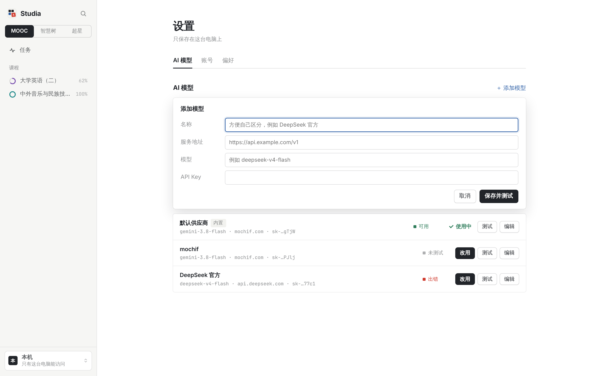

# Studia

网课自动学习 + AI 答题，支持职教云、智慧树、超星学习通。

## 1. 装环境

macOS 终端：

```bash
curl -LsSf https://astral.sh/uv/install.sh | sh
```

Windows PowerShell：

```powershell
powershell -ExecutionPolicy ByPass -c "irm https://astral.sh/uv/install.ps1 | iex"
```

还要装 [Git](https://git-scm.com/downloads)。装完重开终端。

## 2. 下载并启动

```bash
git clone https://github.com/stevia7896/studia.git
```

双击 `studia` 里的 `启动.command`（macOS）或 `启动.bat`（Windows），浏览器会自动打开。首次装依赖要几分钟；窗口别关。

每次启动会自动更新到最新版。要放桌面，用「制作替身」（macOS）或「发送到桌面快捷方式」（Windows），别直接复制。

## 3. 填 API Key

头像 → **设置** → **AI 模型** → **＋ 添加模型**，填好点 **保存并测试**：



| 字段 | 例子 |
| --- | --- |
| 名称 | 随便 |
| 服务地址 | `https://api.deepseek.com/v1` |
| 模型 | `deepseek-chat` |
| API Key | `sk-...` |

报 401 / 404 多半是 Key 错或地址少了 `/v1`。图片题需要能看图的模型。

## 4. 学习和答题

扫码登录 → 点课程：

- **学习**：自动完成视频、文档。
- **答题**：勾选 → **仅生成答案** 或 **AI 作答并交卷**。


已交的显示「已提交」，不会默认勾选；显示「状态未知」的请到平台确认。超星作业整章完成或通过 Studia 交过即算已提交。

## 5. 学习通考试

登录超星学习通 → 点课程 → **考试** 标签 → 选择一场考试 → **保存答案（不交卷）** 或 **AI 考试并交卷**，再次点击确认开始。

考试使用「AI 模型」中当前标记为「使用中」的 API，和答题共用配置。进入考试可能启动平台倒计时；只有整卷作答并确认保存后才自动交卷。考试码、人脸验证或专用客户端要求需在学习通完成。列表可单独刷新，作业仍在「答题」标签。

本机首次使用需安装浏览器：`uv run playwright install --only-shell chromium`；Docker 镜像已包含。此功能已通过离线模拟页面测试，尚未用真实账号验证交卷，首次使用建议选「保存答案（不交卷）」并在学习通核对。

## 6. 更新

启动时自动更新。提示「更新失败」时在 `studia` 文件夹运行 `git pull`（有冲突先 `git stash`）。

---

详细说明见 [docs/USAGE.md](docs/USAGE.md)。代码基于 [yijunjie07/studia](https://github.com/yijunjie07/studia)。
