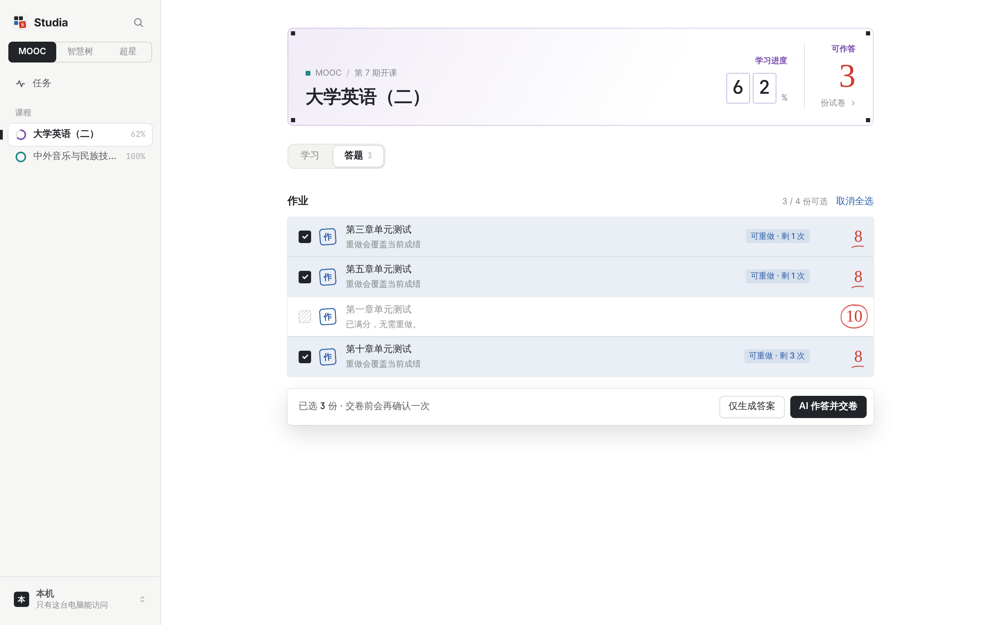
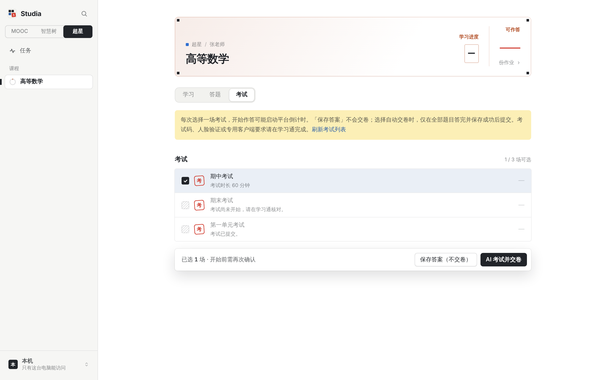

# Studia

网课自动学习 + AI 答题，支持职教云、智慧树、超星学习通。

## 1. 装环境

macOS 终端：

```bash
curl -LsSf https://astral.sh/uv/install.sh | sh
```

Windows PowerShell：

```powershell
powershell -ExecutionPolicy ByPass -c "irm https://astral.sh/uv/install.ps1 | iex"
```

还要装 [Git](https://git-scm.com/downloads)。装完重开终端。

## 2. 下载并启动

```bash
git clone https://github.com/stevia7896/studia.git
```

双击 `studia` 里的 `启动.command`（macOS）或 `启动.bat`（Windows），浏览器会自动打开。首次装依赖要几分钟；窗口别关。

每次启动会自动更新到最新版。要放桌面，用「制作替身」（macOS）或「发送到桌面快捷方式」（Windows），别直接复制。

## 3. 填 API Key

头像 → **设置** → **AI 模型** → **＋ 添加模型**，填好点 **保存并测试**：


下面以 **DeepSeek V4 Flash**（便宜、快，答网课题够用）为例。

**① 拿 API Key**

1. 打开 [platform.deepseek.com](https://platform.deepseek.com/)，手机号注册登录。
2. 左侧 **充值**：先充几块钱就行，余额为 0 会报 401/402。
3. 左侧 **API keys** → **创建 API key** → 复制 `sk-` 开头的那串。**只显示一次**，丢了就删掉重建。

**② 填进 Studia**

| 字段 | 填什么 |
| --- | --- |
| 名称 | 随便，例如 `DeepSeek` |
| 服务地址 | `https://api.deepseek.com/v1` |
| 模型 | `deepseek-v4-flash` |
| API Key | 刚复制的 `sk-...` |

点 **保存并测试**，显示「可用」就好了。

**③ 常见问题**

| 现象 | 原因 |
| --- | --- |
| HTTP 401 | Key 填错、多复制了空格，或账户没余额 |
| HTTP 402 / 429 | 余额不足 / 请求太频繁，充值或稍后再试 |
| HTTP 404 | 模型名拼错，或服务地址写成了网页地址（`platform.deepseek.com` 是控制台，不是接口） |
| 图片题答不了 | `deepseek-v4-flash` 按纯文本用，看不到图，图片题会空着或靠猜。需要的话另加一个能看图的模型 |

- 旧名字 `deepseek-chat` / `deepseek-reasoner` 已被官方弃用，请改用 `deepseek-v4-flash`。想要更强的可以填 `deepseek-v4-pro`，更贵也更慢。模型名以 [DeepSeek 官方文档](https://api-docs.deepseek.com/) 为准。
- 其他服务商同理：服务地址一般以 `/v1` 结尾，报 404 先检查是不是少了 `/v1`。

## 4. 学习和答题

扫码登录 → 点课程：

- **学习**：自动完成视频、文档。
- **答题**：勾选 → **仅生成答案** 或 **AI 作答并交卷**。



已交的显示「已提交」，不会默认勾选；显示「状态未知」的请到平台确认。超星作业整章完成或通过 Studia 交过即算已提交。

## 5. 学习通考试

超星学习通 → 点课程 → **考试** → 选择一场 → **保存答案（不交卷）** 或 **AI 考试并交卷**，再次点击确认。



与答题共用 AI 配置，已提交的不可选。首次使用与限制见 [使用指南](docs/USAGE.md#网页版)。

## 6. 更新

启动时自动更新。提示「更新失败」时在 `studia` 文件夹运行 `git pull`（有冲突先 `git stash`）。

---

详细说明见 [docs/USAGE.md](docs/USAGE.md)。代码基于 [yijunjie07/studia](https://github.com/yijunjie07/studia)。
